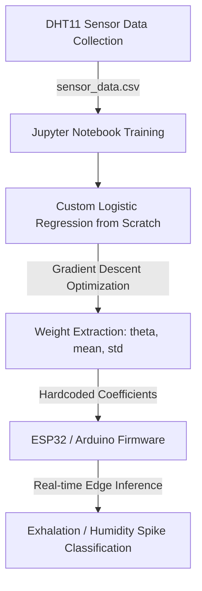
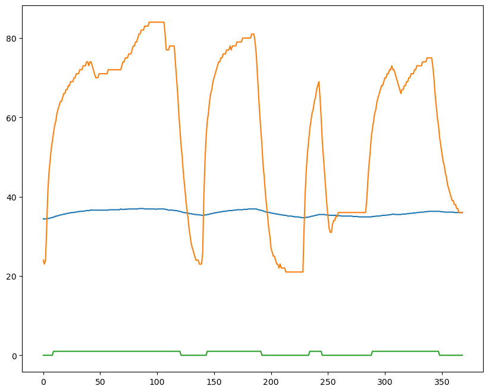
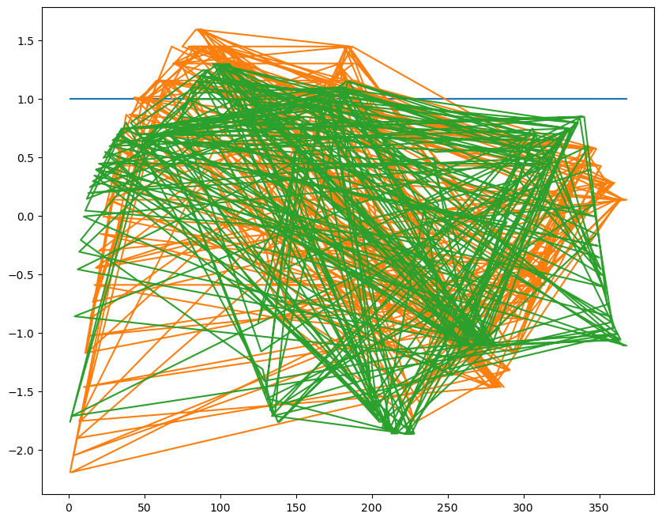
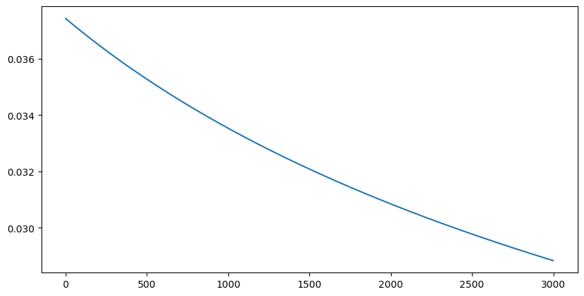

# TinyML Temperature & Humidity Respiration Spike Detector


[](LICENSE)

An educational end-to-end **TinyML edge inference demonstration** that trains a Logistic Regression classifier from scratch in Python (using only NumPy matrix operations) and deploys the learned weights directly onto an ESP32/Arduino microcontroller connected to a **DHT11 temperature and humidity sensor**.

---

## Architecture & Workflow



## Repository Structure

- **[`Humidty_sesnor_tiny_ml.ino`](Humidty_sesnor_tiny_ml.ino)**: Primary Arduino/ESP32 firmware containing the z-score normalization, linear log-odds calculation, sigmoid activation, and serial classification output.
- **[`integration_with_servo.ino`](integration_with_servo.ino)**: Extended firmware variant coupling the spike classifier output to a physical servo actuator.
- **[`Tiny_ml_training_code.ipynb`](Tiny_ml_training_code.ipynb)**: Jupyter Notebook implementing dataset loading, z-score standardization, manual gradient descent training, and loss verification.
- **[`sensor_data.csv`](sensor_data.csv)**: Collected sensor dataset containing raw temperature ($^\circ\text{C}$) and relative humidity ($\text{RH}\%$) samples.

---

## 1. Dataset Collection, Labeling & Physical Rationale

### How DHT11 Readings Relate to Near-Sensor Exhalation Spikes
Human exhaled breath is warm ($\approx 34\text{--}36^\circ\text{C}$) and nearly saturated with water vapor ($\text{RH} > 85\%$). When a subject exhales directly across a close-range ambient humidity sensor, relative humidity exhibits a sharp transient rise above the ambient baseline ($\approx 40\text{--}50\%\text{ RH}$), accompanied by a smaller thermal shift.

### Dataset Provenance & Labeling Rule
- **Collection Setup**: Samples in [`sensor_data.csv`](sensor_data.csv) were logged over serial from a DHT11 sensor during alternating intervals of ambient baseline conditions and close-range directed exhalation bursts.
- **Threshold Labeling**: Binary ground-truth labels were assigned using a deterministic relative-humidity threshold of $55.0\%\text{ RH}$:

$$
\text{Target } y = \begin{cases} 
1 & \text{if } \text{Humidity} > 55.0\% \\ 
0 & \text{otherwise} 
\end{cases}
$$



---

## 2. Offline Model Training & Methodology (Python)

The model is trained using a manual implementation of **Binary Logistic Regression** via full-batch Gradient Descent (`alpha = 0.1`, `3,000 iterations`) without `scikit-learn` training estimators.

1. **Feature Standardization (Z-Score Normalization)**:
   $$X_{\text{scaled}} = \frac{X - \mu}{\sigma}$$
   - **Temperature**: $\mu = 35.9054^\circ\text{C}$, $\sigma = 0.6874^\circ\text{C}$
   - **Humidity**: $\mu = 58.1153\%$, $\sigma = 19.9401\%$

   

2. **Binary Cross-Entropy Loss**:
   $$J(\theta) = -\frac{1}{m} \sum_{i=1}^{m} \left[ y^{(i)} \log(\hat{y}^{(i)}) + (1 - y^{(i)}) \log(1 - \hat{y}^{(i)}) \right]$$
   *(Predicted probabilities $\hat{y}$ are clipped to $[10^{-15}, 1 - 10^{-15}]$ for numerical stability).*

3. **Converged Parameters ($\theta$)**:
   - **Intercept ($\theta_0$)**: `0.984221`
   - **Temperature Weight ($\theta_1$)**: `-0.062587`
   - **Humidity Weight ($\theta_2$)**: `6.727087` *(dominates the decision boundary, as expected given the humidity-threshold label definition).*

   

---

## 3. Limitations & Engineering Caveats

- **Sensor Response Time**: The DHT11 has a slow sampling rate ($\approx 1\text{ Hz}$) and a resistive humidity sensing element with multi-second response/recovery hysteresis. Consequently, this system detects **sustained close-range exhalation/humidity spikes** rather than high-frequency clinical respiratory rate (breaths-per-minute) waveforms.
- **Label Linearly Separable by Construction**: Because the target labels in `sensor_data.csv` were generated from a hard threshold ($\text{RH} > 55\%$) and evaluated on the full dataset without an independent subject holdout split, the training convergence primarily demonstrates the **end-to-end mechanics of manual gradient descent and C++ weight deployment** rather than generalization across diverse environments.

---

## 4. Building & Running

### A. Reproduce the Python Training Pipeline
```bash
git clone https://github.com/usman-irshad1/temperature-sensor-tiny-ml.git
cd temperature-sensor-tiny-ml
pip install numpy pandas matplotlib jupyter
jupyter notebook Tiny_ml_training_code.ipynb
```

### B. Flash the Microcontroller Firmware
1. Open [`Humidty_sesnor_tiny_ml.ino`](Humidty_sesnor_tiny_ml.ino) (or [`integration_with_servo.ino`](integration_with_servo.ino)) in the **Arduino IDE**.
2. Install the **DHT sensor library** by Adafruit via *Tools $\rightarrow$ Manage Libraries*.
3. Wire the DHT11 sensor (`VCC` $\rightarrow$ `3.3V/5V`, `GND` $\rightarrow$ `GND`, `DATA` $\rightarrow$ `GPIO 4`), select your ESP32/Arduino board and COM port, and click **Upload**.
4. Open the **Serial Monitor** (`9600` or `115200` baud as configured in the sketch) to observe real-time feature scaling and spike predictions.

---

## License

This project is open-source and available under the [MIT License](LICENSE).
